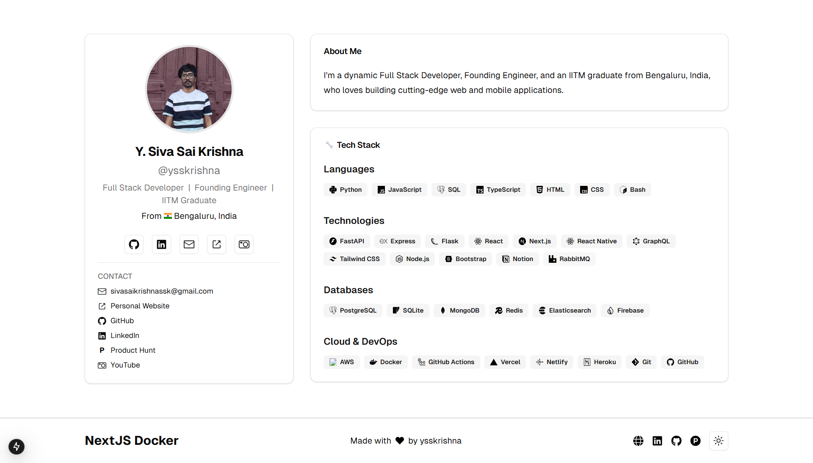
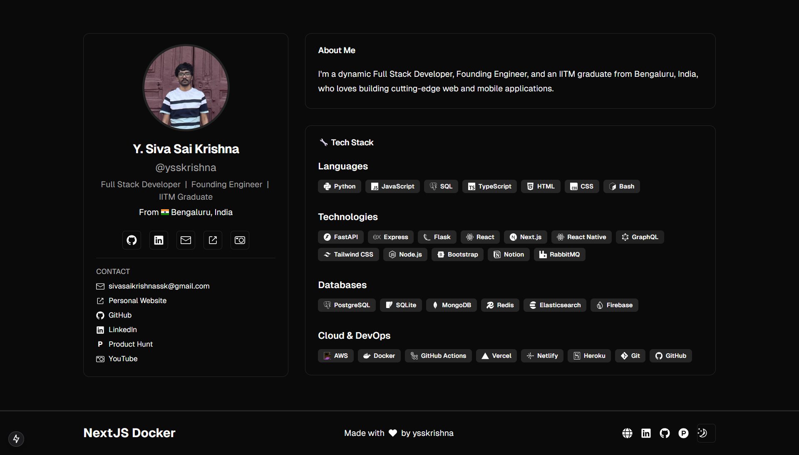
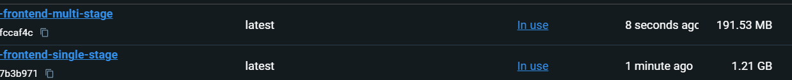

# Next.js Docker Build Strategies Comparison

This repository demonstrates the difference between single-stage and multi-stage Docker builds for a Next.js application. The comparison focuses on build size, security, and best practices.

## Landing Page Preview




## Build Strategies

### Single-Stage Build (`Dockerfile.single`)
The single-stage build uses a straightforward approach where all operations happen in a single Docker layer:
- Uses a single `node:18-alpine` base image
- Installs dependencies and builds the application in the same layer
- Simpler configuration but results in larger image size
- Contains build tools and dependencies in the final image

### Multi-Stage Build (`Dockerfile.multi`)
The multi-stage build uses three distinct stages to optimize the final image:
1. **Dependencies Stage**: Installs production dependencies
2. **Builder Stage**: Builds the application
3. **Runner Stage**: Creates a minimal production image
- Uses `node:18-alpine` as the base image for all stages
- Implements security best practices (non-root user)
- Only includes necessary production files
- Results in a significantly smaller final image

## Running the Comparison

To run both builds and compare their sizes:

```bash
# Build & Run the containers
docker-compose up --build
```

The applications will be available at:
- Single-stage build: http://localhost:3000
- Multi-stage build: http://localhost:3001

## Environment Configuration

Before running the application, you need to set up your environment variables:

1. Copy the `.env.sample` file to create your `.env` file:
```bash
cp .env.sample .env
```

2. Update the values in the `.env` file with your specific configuration.

Note: Make sure to never commit your `.env` file to version control. The `.env.sample` file serves as a template showing which environment variables are required.

## Key Differences

| Aspect       | Single-Stage | Multi-Stage              |
| ------------ | ------------ | ------------------------ |
| Image Size   | Larger       | Smaller                  |
| Build Time   | Faster       | Slightly slower          |
| Security     | Basic        | Enhanced (non-root user) |
| Build Tools  | Included     | Excluded                 |
| Dependencies | All included | Only production          |
| Complexity   | Simple       | More complex             |

## Best Practices Demonstrated

The multi-stage build implements several Docker best practices:
- Separation of build and runtime environments
- Minimal production image
- Security hardening (non-root user)
- Proper handling of static files
- Environment variable configuration
- Proper port exposure

## Image Size Comparison

To compare the final image sizes:

```bash
docker images | grep frontend
```



Current image sizes:
- Single-stage build: 1.22GB
- Multi-stage build: 192MB

The multi-stage build results in an image that's approximately 84% smaller than the single-stage build (1.22GB vs 192MB), as it excludes:
- Build tools
- Development dependencies
- Source code
- Build artifacts
- Node modules (only production dependencies)

## Contributing

Contributions are welcome! Please feel free to submit a Pull Request.

## License

This template is licensed under the MIT License - see the [LICENSE](LICENSE) file for details. 